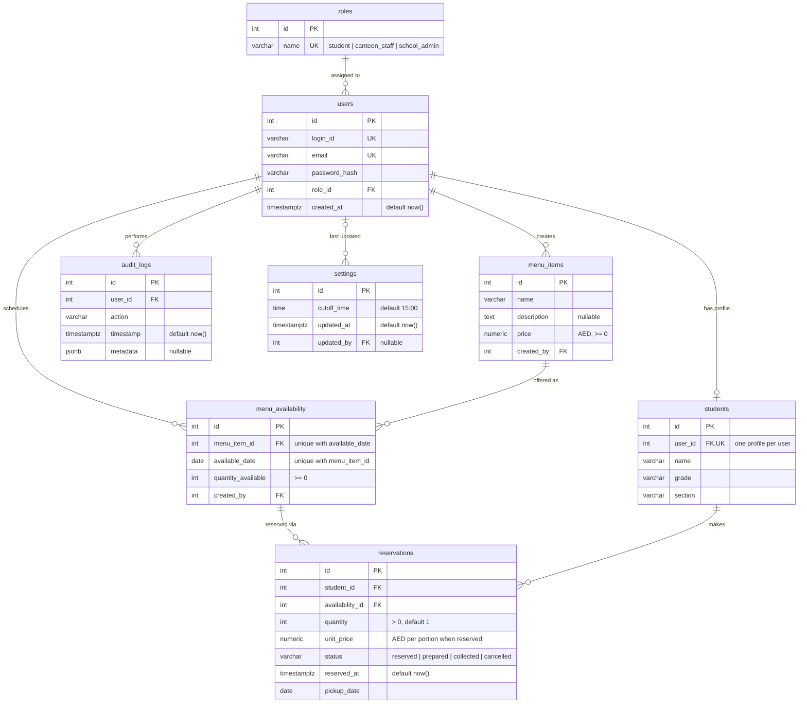

# Database ER Diagram

Entity-relationship diagram of the GIIS Canteen database (PostgreSQL), matching [`schema.sql`](schema.sql) and the latest Alembic migration (`b7e2d5f81c4a`).

## Relationships

| From | To | Cardinality | Via |
|---|---|---|---|
| roles | users | one role, many users | `users.role_id` |
| users | students | one user, at most one student profile | `students.user_id` (unique) |
| users | menu_items | one staff user creates many dishes | `menu_items.created_by` |
| users | menu_availability | one staff user schedules many day entries | `menu_availability.created_by` |
| users | audit_logs | one user, many log entries | `audit_logs.user_id` |
| users | settings | settings optionally record who last changed them | `settings.updated_by` (nullable) |
| menu_items | menu_availability | one dish, offered on many days (once per day) | `menu_availability.menu_item_id` |
| menu_availability | reservations | one day's dish, many reservations | `reservations.availability_id` |
| students | reservations | one student, many reservations | `reservations.student_id` |

## Notes

- **Catalog vs. availability:** `menu_items` is the reusable list of dishes and their price. `menu_availability` says which dish is offered on which date and how many portions there are. Students reserve against `menu_availability`.
- **Portions left** for a dish on a date = `quantity_available` minus the sum of `quantity` over its reservations whose status is not `cancelled`.
- **Price snapshot:** `reservations.unit_price` copies `menu_items.price` when the reservation is made, so later price changes don't alter existing orders. Order total = `quantity × unit_price`.
- **One reservation per dish:** the API (not a database constraint) keeps a student to one active reservation per dish per day. Ordering more of the same dish increases its `quantity`.
- **settings** holds a single row with the school-wide daily cut-off time.
- **Indexes:** `menu_availability(available_date)`, `reservations(student_id)`, `reservations(pickup_date)`, `audit_logs(user_id)`.
