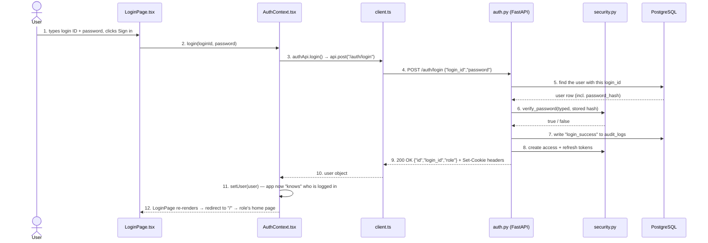

# How Login Works: A Code Walkthrough

This guide follows a single login from the moment someone types their password to the moment they see their dashboard. It names every file and code line involved, and explains *why* each piece exists.

It's written for someone building an app for the first time. You don't need to know React, FastAPI, PostgreSQL or JWTs already. New terms are explained the first time they appear, and there's a [glossary](#glossary) at the end.

> **How to read the code links:** a link like [`auth.py:46`](../backend/app/api/auth.py#L46) means "file `auth.py`, line 46". In VS Code you can click it to jump straight there.

---

## Contents

1. [The big picture](#1-the-big-picture)
2. [Six ideas you need first](#2-six-ideas-you-need-first)
3. [The files involved](#3-the-files-involved)
4. [Step by step: what happens when you open the app](#4-step-by-step-what-happens-when-you-open-the-app)
5. [Step by step: what happens when you click "Sign in"](#5-step-by-step-what-happens-when-you-click-sign-in)
6. [After login: how every other request proves who you are](#6-after-login-how-every-other-request-proves-who-you-are)
7. [Logging out](#7-logging-out)
8. [Changing your password](#8-changing-your-password)
9. [The refresh token (built but not yet used)](#9-the-refresh-token-built-but-not-yet-used)
10. [When things go wrong](#10-when-things-go-wrong)
11. [Why it's built this way, and its current limits](#11-why-its-built-this-way-and-its-current-limits)
12. [See it for yourself](#12-see-it-for-yourself)
13. [Glossary](#glossary)

---

## 1. The big picture

The app is made of **three separate programs** that talk to each other:

```
 ┌──────────────────────────┐      HTTP requests       ┌──────────────────────────┐       SQL queries      ┌──────────────────────┐
 │  FRONTEND                │  ─────────────────────▶  │  BACKEND                 │  ───────────────────▶  │  DATABASE            │
 │  React app in the browser│                          │  FastAPI (Python)        │                        │  PostgreSQL          │
 │  http://localhost:5173   │  ◀─────────────────────  │  http://localhost:8000   │  ◀───────────────────  │  tables: users, roles│
 │                          │   JSON responses +       │                          │     rows of data       │  audit_logs, ...     │
 │  What the user sees      │   cookies                │  Checks passwords,       │                        │  Stores everything   │
 │  and clicks              │                          │  makes tokens            │                        │  permanently         │
 └──────────────────────────┘                          └──────────────────────────┘                        └──────────────────────┘
```

- **Frontend:** the website, made with React. It runs *inside the user's browser*. It draws the login form and sends what the user typed to the backend. It **never** sees the database and **never** checks passwords itself.
- **Backend:** a Python program made with FastAPI. It runs on a server (your PC, during development). It's the only part allowed to read the database. It decides whether a password is correct.
- **Database:** PostgreSQL. It stores user accounts in tables. It only answers the backend.

Why split it up? The browser is under the user's control. Anyone can open the browser's developer tools and change what the frontend does. So anything that must be trusted, like checking a password or deciding who may see what, has to happen on the backend.

Here is the whole login as a sequence. Each numbered arrow is explained in [section 5](#5-step-by-step-what-happens-when-you-click-sign-in).



---

## 2. Six ideas you need first

### 2.1 Requests and responses (HTTP)
The frontend and backend talk using **HTTP**, the same language your browser uses to load any website. The frontend sends a **request** and the backend sends back a **response**.

A request has:
- a **method**: what kind of action it is. `GET` means "give me something" and `POST` means "here's some data, do something with it";
- a **path**: which feature it's for, e.g. `/auth/login`;
- optionally a **body**, the data being sent.

A response has a **status code**, a number saying how it went. `200` means OK, `401` means "you're not logged in or your login failed", and `403` means "you're logged in but not allowed to do this". It can also carry a body.

### 2.2 JSON
**JSON** is the text format the body is written in. It looks like this:
```json
{ "login_id": "admin", "password": "secret" }
```

### 2.3 Password hashing
The database **never stores your actual password**. It stores a **hash**: the result of running the password through a one-way scrambling function called **bcrypt**. A stored hash looks like `$2b$12$Kx9...` (60 characters).

"One-way" means you can't turn the hash back into the password. To check a login, the backend hashes what you typed in the same way and compares the results. So if the database is ever stolen, the attackers still don't have anyone's password.

### 2.4 Tokens (JWT)
After you log in, the backend shouldn't make you send your password with every click. Instead it gives you a **token**, a bit like a wristband at an event. You show the wristband instead of your ticket.

This app uses **JWTs** (JSON Web Tokens). A JWT is a long string with three parts separated by dots. The middle part holds readable data such as:
```json
{ "sub": "1", "role": "school_admin", "type": "access", "iat": 1730000000, "exp": 1730000900 }
```
- `sub` (subject) is the user's id.
- `iat` is when the token was issued and `exp` is when it expires, both as a count of seconds.
- The last part is a **signature**, made with a secret key that only the backend knows (`JWT_SECRET_KEY` in `backend/.env`).

If anyone changes even one character of the token, the signature no longer matches and the backend rejects it. That's why the token can be trusted even though the user holds it.

The app makes two tokens:
- an **access token**, which lasts 15 minutes and is used on every request;
- a **refresh token**, which lasts 7 days and is meant for getting a new access token (see [section 9](#9-the-refresh-token-built-but-not-yet-used)).

### 2.5 Cookies (and why "HttpOnly")
A **cookie** is a small piece of data the backend asks the browser to store. The browser then **automatically attaches it to every later request** to that backend. This app stores the tokens in cookies.

The cookies are marked **HttpOnly**, which means JavaScript running in the page *cannot read them*. If a bad script ever got into the page, it still couldn't steal the tokens. Only the browser itself handles them.

### 2.6 React state and context
In React, **state** is data the screen depends on. When state changes, React redraws the affected parts of the screen automatically.

**Context** is a way to share one piece of state with every component in the app without passing it down by hand. This app keeps "who is logged in" in a context called `AuthContext`, so any page can ask "is someone logged in, and what's their role?".

---

## 3. The files involved

| Layer | File | Its job in login |
|-------|------|------------------|
| Frontend | [`frontend/src/main.tsx`](../frontend/src/main.tsx) | Starts the React app and wraps it in `AuthProvider` so every page can use the login state |
| Frontend | [`frontend/src/context/AuthContext.tsx`](../frontend/src/context/AuthContext.tsx) | Holds the logged-in `user`; provides `login()` and `logout()`; checks for an existing session on startup |
| Frontend | [`frontend/src/pages/LoginPage.tsx`](../frontend/src/pages/LoginPage.tsx) | The login form |
| Frontend | [`frontend/src/api/auth.ts`](../frontend/src/api/auth.ts) | One function per auth endpoint (`login`, `me`, `logout`, `changePassword`) |
| Frontend | [`frontend/src/api/client.ts`](../frontend/src/api/client.ts) | The single place that actually sends HTTP requests; turns errors into `ApiError` |
| Frontend | [`frontend/src/api/types.ts`](../frontend/src/api/types.ts) | The `AuthUser` shape: `{ id, login_id, role }` |
| Frontend | [`frontend/src/App.tsx`](../frontend/src/App.tsx) | The list of pages (routes); sends each role to its home page |
| Frontend | [`frontend/src/components/ProtectedRoute.tsx`](../frontend/src/components/ProtectedRoute.tsx) | Blocks pages for people who aren't logged in or have the wrong role |
| Frontend | [`frontend/src/components/PortalLayout.tsx`](../frontend/src/components/PortalLayout.tsx) | The sidebar with the "Change password" and "Log out" buttons |
| Backend | [`backend/app/main.py`](../backend/app/main.py) | Creates the FastAPI app, allows the frontend's address (CORS), logs every request |
| Backend | [`backend/app/api/auth.py`](../backend/app/api/auth.py) | The `/auth/...` endpoints: login, refresh, me, change-password, logout |
| Backend | [`backend/app/schemas/auth.py`](../backend/app/schemas/auth.py) | Describes what the login request and response must look like |
| Backend | [`backend/app/core/security.py`](../backend/app/core/security.py) | Password hashing and token creation/checking |
| Backend | [`backend/app/core/dependencies.py`](../backend/app/core/dependencies.py) | `get_current_user` and `require_role`: reused by every protected endpoint |
| Backend | [`backend/app/core/audit.py`](../backend/app/core/audit.py) | Writes a row to the audit log |
| Backend | [`backend/app/database.py`](../backend/app/database.py) | Opens a database session for each request |
| Backend | [`backend/app/config.py`](../backend/app/config.py) | Reads settings like the secret key and token lifetimes from `backend/.env` |
| Backend | [`backend/app/models/user.py`](../backend/app/models/user.py), [`role.py`](../backend/app/models/role.py) | Python classes that map to the `users` and `roles` tables |
| Database | `users`, `roles`, `audit_logs` tables | Defined in [`database/schema.sql`](../database/schema.sql) |

---

## 4. Step by step: what happens when you open the app

Before anyone types anything, the app must decide: *is this person already logged in?* Maybe they logged in 5 minutes ago and just refreshed the page. React forgets everything on a page refresh, but the browser still has the cookies.

**Step 4.1: the app starts.** [`main.tsx:8-16`](../frontend/src/main.tsx#L8-L16) renders the app inside three wrappers:
```tsx
<BrowserRouter>       {/* lets the app have pages like /login and /student/menu */}
  <AuthProvider>      {/* shares login state with every page */}
    <App />
  </AuthProvider>
</BrowserRouter>
```

**Step 4.2: `AuthProvider` sets its starting state.** [`AuthContext.tsx:16-17`](../frontend/src/context/AuthContext.tsx#L16-L17):
```tsx
const [user, setUser] = useState<AuthUser | null>(null);   // nobody known yet
const [loading, setLoading] = useState(true);               // still checking
```

**Step 4.3: it asks the backend "who am I?".** [`AuthContext.tsx:19-25`](../frontend/src/context/AuthContext.tsx#L19-L25):
```tsx
useEffect(() => {
  authApi
    .me()                          // GET /auth/me
    .then(setUser)                 // success → remember the user
    .catch(() => setUser(null))    // failure → nobody logged in
    .finally(() => setLoading(false));
}, []);
```
`useEffect(..., [])` means "run this once, when the component first appears".

> In development you'll see `/auth/me` called **twice** in the backend log. That's React's `StrictMode` deliberately running effects twice to help catch bugs. It doesn't happen in a production build.

**Step 4.4: while it waits, pages show a spinner.** [`App.tsx:31`](../frontend/src/App.tsx#L31) and [`ProtectedRoute.tsx:10`](../frontend/src/components/ProtectedRoute.tsx#L10) both say `if (loading) return <LoadingScreen />;`. Without this, the app would flash the login page for a split second before realising you're logged in.

**Step 4.5: the backend answers `/auth/me`.** [`auth.py:85-88`](../backend/app/api/auth.py#L85-L88):
```python
@router.get("/me", response_model=LoginResponse)
def me(current_user: User = Depends(get_current_user)):
    return LoginResponse(id=current_user.id, login_id=current_user.login_id, role=current_user.role.name)
```
All the real work is in `get_current_user`, which reads and checks the access-token cookie. That function is explained in [section 6](#6-after-login-how-every-other-request-proves-who-you-are).
- **Valid cookie:** it returns `200` with `{ id, login_id, role }`, and the user goes straight to their dashboard.
- **No cookie, or an expired one:** it returns `401`, and the user is sent to `/login`.

---

## 5. Step by step: what happens when you click "Sign in"

### Frontend: from the form to the network

**Step 1: the form keeps what you type.** [`LoginPage.tsx:9-10`](../frontend/src/pages/LoginPage.tsx#L9-L10) creates two pieces of state, and the inputs at [lines 49-55](../frontend/src/pages/LoginPage.tsx#L49-L55) and [59-65](../frontend/src/pages/LoginPage.tsx#L59-L65) update them on every keystroke:
```tsx
const [loginId, setLoginId] = useState("");
const [password, setPassword] = useState("");
...
<input value={loginId} onChange={(e) => setLoginId(e.target.value)} required />
<input type="password" value={password} onChange={(e) => setPassword(e.target.value)} required />
```
`type="password"` shows dots instead of letters. `required` makes the browser refuse to submit an empty field.

**Step 2: you click "Sign in".** The form calls `handleSubmit` at [`LoginPage.tsx:18-29`](../frontend/src/pages/LoginPage.tsx#L18-L29):
```tsx
async function handleSubmit(e: FormEvent) {
  e.preventDefault();          // stop the browser's old-fashioned full-page form submit
  setError(null);              // clear any previous error message
  setSubmitting(true);         // button now says "Signing in…" and is disabled
  try {
    await login(loginId, password);   // ← hand over to AuthContext
  } catch (err) {
    setError(err instanceof ApiError ? err.message : "Something went wrong. Please try again.");
  } finally {
    setSubmitting(false);
  }
}
```
`login` comes from `useAuth()` at [line 8](../frontend/src/pages/LoginPage.tsx#L8). The page doesn't know *how* login works. It just asks the context to do it.

**Step 3: `AuthContext` calls the API wrapper.** [`AuthContext.tsx:27-30`](../frontend/src/context/AuthContext.tsx#L27-L30):
```tsx
async function login(loginId: string, password: string) {
  const loggedInUser = await authApi.login(loginId, password);
  setUser(loggedInUser);
}
```
And [`auth.ts:5-6`](../frontend/src/api/auth.ts#L5-L6) turns that into a request description:
```ts
login: (login_id: string, password: string) =>
  api.post<AuthUser>("/auth/login", { login_id, password }),
```
Note the rename from `loginId` (JavaScript style) to `login_id` (what the backend expects).

**Step 4: `client.ts` sends the request.** [`client.ts:12-20`](../frontend/src/api/client.ts#L12-L20):
```ts
const res = await fetch(`${BASE_URL}${path}`, {     // http://localhost:8000/auth/login
  ...options,                                       // method: "POST", body: '{"login_id":"admin","password":"..."}'
  credentials: "include",                           // ← send and accept cookies
  headers: { "Content-Type": "application/json" },  // "the body is JSON"
});
```
- `BASE_URL` comes from `VITE_API_BASE_URL` in `frontend/.env` ([line 1](../frontend/src/api/client.ts#L1)).
- **`credentials: "include"` is essential.** The frontend (port 5173) and backend (port 8000) are different *origins*. By default the browser won't save or send cookies on requests between them. This line tells it to.

What actually goes over the network:
```http
POST /auth/login HTTP/1.1
Host: localhost:8000
Origin: http://localhost:5173
Content-Type: application/json

{"login_id":"admin","password":"ChangeMe123!"}
```

> **Is sending the password safe?** On your PC it travels in plain text, which is fine for local development. In production the site must use **HTTPS**, which encrypts everything between the browser and the server. See `COOKIE_SECURE` in [section 11](#11-why-its-built-this-way-and-its-current-limits).

### Backend: from the network to the database and back

**Step 5a: CORS lets the request in.** Browsers protect users by blocking a page on one origin from reading responses from another, unless the server says it's allowed. [`main.py:15-21`](../backend/app/main.py#L15-L21):
```python
app.add_middleware(
    CORSMiddleware,
    allow_origins=settings.cors_origins,   # ["http://localhost:5173", "http://localhost:3000"]
    allow_credentials=True,                # cookies are allowed on cross-origin requests
    ...
)
```
This is the backend's half of `credentials: "include"`. **Both halves are needed**, or the login cookies silently won't work. The allowed addresses come from `CORS_ORIGINS` in [`config.py`](../backend/app/config.py).

**Step 5b: the request is logged.** The middleware at [`main.py:24-31`](../backend/app/main.py#L24-L31) wraps every request and prints a line like `POST /auth/login -> 200 (245.3ms)`. It never logs the body, so passwords don't end up in the log.

**Step 5c: FastAPI picks the function and checks the body.** The router at [`auth.py:18`](../backend/app/api/auth.py#L18) has `prefix="/auth"`, and [`auth.py:46`](../backend/app/api/auth.py#L46) has `@router.post("/login")`. Together they mean that `POST /auth/login` runs the `login` function.

Its parameters tell FastAPI what to prepare first ([line 47](../backend/app/api/auth.py#L47)):
```python
def login(payload: LoginRequest, response: Response, db: Session = Depends(get_db)):
```
- **`payload: LoginRequest`**: FastAPI parses the JSON body and checks it against [`schemas/auth.py:4-6`](../backend/app/schemas/auth.py#L4-L6):
  ```python
  class LoginRequest(BaseModel):
      login_id: str
      password: str
  ```
  If a field is missing or the wrong type, FastAPI replies `422` automatically and your function never runs.
- **`response: Response`**: an empty response object the function can attach cookies to.
- **`db: Session = Depends(get_db)`**: a database connection. `Depends(...)` is FastAPI's **dependency injection**: "before calling `login`, run `get_db` and pass in what it gives". [`database.py:14-19`](../backend/app/database.py#L14-L19) opens a session, hands it over, and closes it after the response is sent, even if an error happened.

**Step 5d: look up the user.** [`auth.py:48`](../backend/app/api/auth.py#L48):
```python
user = db.query(User).filter(User.login_id == payload.login_id).first()
```
SQLAlchemy, the library that maps Python classes to tables, turns this into SQL roughly like:
```sql
SELECT id, login_id, email, password_hash, role_id, created_at
FROM users WHERE login_id = 'admin' LIMIT 1;
```
The result is a `User` object (defined in [`models/user.py`](../backend/app/models/user.py)), or `None` if no one has that login ID. `login_id` is `UNIQUE` in the database, so there can't be two matches.

**Step 6: check the password.** [`auth.py:50`](../backend/app/api/auth.py#L50) calls `verify_password` in [`security.py:15-16`](../backend/app/core/security.py#L15-L16):
```python
def verify_password(password: str, password_hash: str) -> bool:
    return bcrypt.checkpw(password.encode("utf-8"), password_hash.encode("utf-8"))
```
bcrypt reads the random "salt" stored inside the hash, hashes the typed password with it, and compares the two. bcrypt is deliberately slow, around a quarter of a second, which makes guessing millions of passwords impractical.

If the user doesn't exist **or** the password is wrong ([`auth.py:50-54`](../backend/app/api/auth.py#L50-L54)):
```python
if user is None or not verify_password(payload.password, user.password_hash):
    if user is not None:
        log_action(db, user.id, "login_failure")   # record the failed attempt
        db.commit()
    raise HTTPException(status.HTTP_401_UNAUTHORIZED, "Invalid credentials")
```
Notice the message is the same, "Invalid credentials", in both cases. Saying "no such user" would tell an attacker which login IDs exist.

**Step 7: record the success.** [`auth.py:56-57`](../backend/app/api/auth.py#L56-L57):
```python
log_action(db, user.id, "login_success")
db.commit()
```
[`audit.py:8-9`](../backend/app/core/audit.py#L8-L9) adds a row to `audit_logs`. `db.commit()` is what actually saves it; until then, database changes are only pending. Admins can see these rows on the **Audit Log** page.

**Step 8: make the tokens and put them in cookies.** [`auth.py:59`](../backend/app/api/auth.py#L59) calls `_set_auth_cookies` ([lines 24-43](../backend/app/api/auth.py#L24-L43)):
```python
access_token = create_access_token(user.id, user.role.name)
refresh_token = create_refresh_token(user.id, user.role.name)

response.set_cookie(
    "access_token", access_token,
    httponly=True,                       # page JavaScript can't read it
    secure=settings.cookie_secure,       # if True: only sent over HTTPS
    samesite="lax",                      # not sent when another website submits a form here
    max_age=settings.access_token_expire_minutes * 60,   # browser deletes it after 15 min
)
# ...same again for "refresh_token", with max_age = 7 days
```
`user.role.name` follows the link from `users.role_id` to the `roles` table, so SQLAlchemy runs one more small query here to get `"student"`, `"canteen_staff"` or `"school_admin"`.

The tokens themselves are built in [`security.py:24-33`](../backend/app/core/security.py#L24-L33):
```python
payload = {
    "sub": str(subject),      # user id
    "role": role,
    "type": token_type,       # "access" or "refresh"
    "iat": now,
    "exp": now + expires_delta,
}
return jwt.encode(payload, settings.jwt_secret_key, algorithm=settings.jwt_algorithm)
```

**Step 9: send the response.** [`auth.py:60`](../backend/app/api/auth.py#L60):
```python
return LoginResponse(id=user.id, login_id=user.login_id, role=user.role.name)
```
`response_model=LoginResponse` on [line 46](../backend/app/api/auth.py#L46) guarantees that only these three fields leave the server. Even by accident, `password_hash` or `email` can't leak.

What the browser receives:
```http
HTTP/1.1 200 OK
Access-Control-Allow-Origin: http://localhost:5173
Access-Control-Allow-Credentials: true
Set-Cookie: access_token=eyJhbGciOi...; HttpOnly; Max-Age=900; Path=/; SameSite=lax
Set-Cookie: refresh_token=eyJhbGciOi...; HttpOnly; Max-Age=604800; Path=/; SameSite=lax
Content-Type: application/json

{"id":1,"login_id":"admin","role":"school_admin"}
```
The browser stores both cookies **on its own**. No frontend code touches them.

### Frontend again: from the response to the dashboard

**Step 10: `client.ts` reads the reply.** The status is 200, so `res.ok` is true and [`client.ts:37`](../frontend/src/api/client.ts#L37) returns the parsed JSON `{ id, login_id, role }`.

**Step 11: `AuthContext` remembers the user.** Back at [`AuthContext.tsx:29`](../frontend/src/context/AuthContext.tsx#L29), `setUser(loggedInUser)` updates the shared state. Every component that called `useAuth()` is now redrawn with the new `user`.

**Step 12: the login page sends you onward.** `LoginPage` redraws, and now [`LoginPage.tsx:14-16`](../frontend/src/pages/LoginPage.tsx#L14-L16) is true:
```tsx
if (user) {
  return <Navigate to="/" replace />;
}
```
At `/`, `HomeRedirect` in [`App.tsx:29-42`](../frontend/src/App.tsx#L29-L42) picks the home page for the role:

| Role | Goes to |
|------|---------|
| `student` | `/student/menu` |
| `canteen_staff` | `/canteen/menu` |
| `school_admin` | `/admin/users` |

That page is wrapped in `ProtectedRoute` ([`App.tsx:53`](../frontend/src/App.tsx#L53), [71](../frontend/src/App.tsx#L71), [93](../frontend/src/App.tsx#L93)), which does a final check ([`ProtectedRoute.tsx:10-14`](../frontend/src/components/ProtectedRoute.tsx#L10-L14)):
```tsx
if (loading) return <LoadingScreen />;
if (!user) return <Navigate to="/login" replace />;                       // not logged in
if (!allowedRoles.includes(user.role)) return <Navigate to="/" replace />; // wrong portal
return <>{children}</>;                                                   // ✅ show the page
```
**You're in.**

> ⚠️ **`ProtectedRoute` is for convenience, not security.** It only hides pages in the browser, and a user could get around it. The real protection is on the backend, which checks the token and role on *every* request (next section). If the frontend check were removed, a student still couldn't load admin data.

---

## 6. After login: how every other request proves who you are

Say a student opens the menu. The frontend calls `GET /menu` through the same `client.ts`. Because of `credentials: "include"`, the browser **automatically** adds:
```http
Cookie: access_token=eyJhbGciOi...; refresh_token=eyJhbGciOi...
```

On the backend, every student endpoint is protected by one line, [`student.py:19`](../backend/app/api/student.py#L19):
```python
router = APIRouter(tags=["student"], dependencies=[Depends(require_role("student"))])
```
The canteen and admin routers do the same with `"canteen_staff"` and `"school_admin"`. Before any endpoint runs, FastAPI runs two checks.

**Check 1: who is this?** `get_current_user` in [`dependencies.py:9-26`](../backend/app/core/dependencies.py#L9-L26):
```python
token = request.cookies.get("access_token")
if token is None:
    raise HTTPException(401, "Not authenticated")            # no wristband

try:
    payload = decode_token(token)                             # checks signature AND expiry
except ValueError:
    raise HTTPException(401, "Invalid or expired token")      # fake or too old

if payload.get("type") != "access":
    raise HTTPException(401, "Invalid token type")            # someone sent the refresh token instead

user = db.get(User, int(payload["sub"]))                      # load the user from the database
if user is None:
    raise HTTPException(401, "User not found")                # account was deleted

return user
```
`decode_token` ([`security.py:48-52`](../backend/app/core/security.py#L48-L52)) uses the secret key to confirm the token is genuine and unchanged, and that `exp` hasn't passed.

**Check 2: are they allowed?** `require_role` in [`dependencies.py:29-35`](../backend/app/core/dependencies.py#L29-L35):
```python
def require_role(*allowed_roles: str):
    def dependency(user: User = Depends(get_current_user)) -> User:
        if user.role.name not in allowed_roles:
            raise HTTPException(403, "Insufficient permissions")
        return user
    return dependency
```
Note that the role is read from the **database** (`user.role.name`), not from the token. If an admin changes someone's role, it takes effect on their next request.

| Situation | Result |
|-----------|--------|
| No cookie, bad token, expired token, deleted user | `401 Unauthorized` |
| Valid token, but a student calls `/admin/...` | `403 Forbidden` |
| Valid token, correct role | The endpoint runs |

---

## 7. Logging out

1. The **Log out** button in [`PortalLayout.tsx:66-67`](../frontend/src/components/PortalLayout.tsx#L66-L67) calls `logout()` from the context.
2. [`AuthContext.tsx:32-39`](../frontend/src/context/AuthContext.tsx#L32-L39) calls `POST /auth/logout`, then `setUser(null)`. If the request fails with an `ApiError`, it still clears the user, so the person is logged out in the browser either way.
3. The backend, [`auth.py:107-111`](../backend/app/api/auth.py#L107-L111), replies with headers telling the browser to delete both cookies:
   ```python
   response.delete_cookie("access_token")
   response.delete_cookie("refresh_token")
   ```
4. With `user` now `null`, `ProtectedRoute` redirects to `/login`.

---

## 8. Changing your password

1. **Change password** in the sidebar ([`PortalLayout.tsx:59-65`](../frontend/src/components/PortalLayout.tsx#L59-L65)) opens `ChangePasswordModal`. That modal calls `authApi.changePassword(current, new)` → `POST /auth/change-password`.
2. The backend endpoint ([`auth.py:91-104`](../backend/app/api/auth.py#L91-L104)) first requires a logged-in user via `Depends(get_current_user)`. It then:
   - checks the **current** password with `verify_password`, returning `400 "Current password is incorrect"` if it's wrong;
   - hashes the new password with `hash_password` ([`security.py:11-12`](../backend/app/core/security.py#L11-L12)), which generates a fresh random salt each time;
   - saves it and writes `password_changed` to the audit log.

Asking for the current password means someone who finds your laptop unlocked can't silently change it.

---

## 9. The refresh token (built but not yet used)

The idea behind two tokens:
- The **access token** is sent constantly, so it's kept short-lived (15 minutes). If one is ever stolen, it soon stops working.
- The **refresh token** lasts 7 days. When the access token expires, the frontend is supposed to call `POST /auth/refresh` and get a fresh pair, without the user typing their password again.

The backend side exists: [`auth.py:63-82`](../backend/app/api/auth.py#L63-L82) reads the `refresh_token` cookie, checks it's genuine and of `type == "refresh"`, and sets new cookies.

**However, the frontend never calls it.** [`auth.ts`](../frontend/src/api/auth.ts) has no `refresh` function, and [`client.ts`](../frontend/src/api/client.ts) doesn't retry when it gets a `401`. So in practice:
- **About 15 minutes after logging in,** the browser deletes the access cookie (its `Max-Age`), and API calls start failing with `401`. The page shows an error such as "Not authenticated".
- **Refreshing the page** runs the `/auth/me` check from [section 4](#4-step-by-step-what-happens-when-you-open-the-app). It fails, so the user lands on the login page and must sign in again.

To make sessions last the full 7 days, the usual fix is:
- add `refresh: () => api.post("/auth/refresh")` to `auth.ts`;
- in `client.ts`, when a request gets a `401`, call `refresh` once and then retry the original request.

---

## 10. When things go wrong

| What the user sees | Where it comes from | Why |
|--------------------|---------------------|-----|
| "Invalid credentials" | [`auth.py:54`](../backend/app/api/auth.py#L54) → `ApiError` → [`LoginPage.tsx:25`](../frontend/src/pages/LoginPage.tsx#L25) | Wrong login ID or password |
| "Something went wrong. Please try again." | [`LoginPage.tsx:25`](../frontend/src/pages/LoginPage.tsx#L25) | The request never got an answer: backend not running, wrong `VITE_API_BASE_URL`, or blocked by CORS |
| Browser console: "blocked by CORS policy" | The browser | The frontend's address isn't in `CORS_ORIGINS` |
| Login "succeeds" but you bounce back to the login page | Cookies not saved or sent | Usually a missing `credentials: "include"`, `allow_credentials=True`, or `COOKIE_SECURE=true` while using plain `http://` |
| "Not authenticated" after ~15 minutes | [`dependencies.py:12`](../backend/app/core/dependencies.py#L12) | The access token expired; see [section 9](#9-the-refresh-token-built-but-not-yet-used) |
| "Insufficient permissions" | [`dependencies.py:32`](../backend/app/core/dependencies.py#L32) | Logged in, but the wrong role for that endpoint |

How an error travels back to the screen: the backend raises `HTTPException(401, "Invalid credentials")`, and FastAPI turns it into `{"detail": "Invalid credentials"}` with status 401. [`client.ts:22-30`](../frontend/src/api/client.ts#L22-L30) sees `!res.ok`, reads `body.detail` and throws `new ApiError(401, "Invalid credentials")`. `LoginPage`'s `catch` puts that message into an `ErrorBanner`.

---

## 11. Why it's built this way, and its current limits

**Good practices already in place**
- **Passwords are hashed with bcrypt**, never stored or logged in plain text.
- **Tokens are in HttpOnly cookies**, so page JavaScript can't steal them.
- **The error message is the same** for an unknown user and a wrong password.
- **The backend checks every request**, so hiding pages in the frontend isn't the only protection.
- **Roles are read from the database** on each request, so role changes apply immediately.
- **The response model** stops sensitive fields like `password_hash` from being sent by accident.
- **Login attempts are audited.**

**Limits worth knowing about**
- **The refresh token is unused,** so sessions effectively last 15 minutes ([section 9](#9-the-refresh-token-built-but-not-yet-used)).
- **Logout doesn't invalidate tokens on the server.** It deletes the browser's cookies, but a token copied before logout keeps working until it expires. That's normal for simple JWT setups. A stricter app would keep a server-side list of revoked tokens.
- **There's no limit on login attempts.** Someone could keep guessing passwords. A common fix is to lock out or slow down an account or IP address after several failures.
- **Failed logins for unknown login IDs aren't audited.** There's no user id to attach them to ([`auth.py:51`](../backend/app/api/auth.py#L51)).
- **Response times can hint whether a login ID exists.** Wrong passwords for real users take about a quarter of a second (bcrypt runs), while unknown users are answered instantly.
- **For production:**
  - serve the app over **HTTPS**;
  - set `COOKIE_SECURE=true` so cookies are never sent unencrypted;
  - use a long random `JWT_SECRET_KEY`. Anyone who knows the key can forge tokens for any user.

---

## 12. See it for yourself

**Watch the requests in your browser**
1. Open http://localhost:5173 and press `F12` to open the developer tools. Go to the **Network** tab.
2. Sign in. Click the `login` request to see the request body, the `200` status, the `Set-Cookie` headers and the JSON response.
3. Go to **Application** (Chrome/Edge) or **Storage** (Firefox), then **Cookies** → `http://localhost:8000`. You'll see `access_token` and `refresh_token`, with ✓ in the HttpOnly column.
4. Click around the app and look at any later request's **Request Headers**. The `Cookie:` line is added automatically.

**Look inside a token**
A JWT's middle part is just encoded, not encrypted. Copy an `access_token` value from your **local development** app and paste it into a JWT decoder such as jwt.io to see `sub`, `role`, `type` and `exp`.

> Never paste tokens from a real, live system into a website. They work like passwords until they expire.

**Watch the backend log**
The terminal running `uvicorn` shows each request as it arrives:
```
INFO POST /auth/login -> 200 (251.4ms)
INFO GET /auth/me -> 200 (6.2ms)
```

**Try the API without the frontend**
Open http://localhost:8000/docs, expand `POST /auth/login`, click **Try it out**, and send a login ID and password.

**Look at the database**
```sql
-- the stored hash (never the real password)
SELECT login_id, password_hash FROM users;

-- recent login attempts
SELECT user_id, action, timestamp FROM audit_logs ORDER BY timestamp DESC LIMIT 10;
```

---

## Glossary

| Term | Meaning |
|------|---------|
| **API** | The set of URLs the backend offers for the frontend to call |
| **Endpoint** | One of those URLs plus its method, e.g. `POST /auth/login` |
| **HTTP status code** | A number in the response saying how it went: `200` OK, `401` not logged in, `403` not allowed, `422` bad request body |
| **JSON** | The text format used for request and response bodies |
| **Hash / bcrypt** | A one-way scramble of a password; bcrypt is a slow, salted hashing method designed for passwords |
| **Salt** | Random data mixed into each hash, so two people with the same password get different hashes |
| **JWT** | JSON Web Token, a signed string carrying who you are and when it expires |
| **Access token / refresh token** | A short-lived token used on every request / a long-lived token for getting new access tokens |
| **Cookie** | Data the browser stores for a website and sends back with each request to it |
| **HttpOnly** | A cookie setting that hides the cookie from page JavaScript |
| **SameSite** | A cookie setting that controls whether it's sent with requests triggered by other websites |
| **Origin** | Scheme + host + port, e.g. `http://localhost:5173`. Different port means different origin |
| **CORS** | Cross-Origin Resource Sharing, the rules that let the backend allow requests from the frontend's origin |
| **React component** | A function that returns part of the screen, e.g. `LoginPage` |
| **State (`useState`)** | Data a component remembers; changing it redraws the screen |
| **Context (`useContext`)** | A way to share state with every component, used here for "who is logged in" |
| **Effect (`useEffect`)** | Code that runs after a component appears, used here to call `/auth/me` on startup |
| **Route** | A URL path mapped to a page, e.g. `/student/menu` → `StudentMenuPage` |
| **FastAPI router** | A group of endpoints sharing a path prefix and checks, e.g. everything under `/auth` |
| **Dependency (`Depends`)** | A function FastAPI runs before your endpoint, e.g. opening the database or checking the logged-in user |
| **Pydantic schema** | A class describing the exact shape of request or response data; FastAPI uses it to validate |
| **SQLAlchemy model / ORM** | A Python class mapped to a database table, so you can query with Python instead of raw SQL |
| **Session / commit** | A database conversation; changes are only saved when you `commit()` |
| **Audit log** | A permanent record of important actions such as logins and admin changes |
